<h3><code>arijit@github:~$ ./contributions.sh</code></h3>

 
<!-- link strip: docked under the graph as its footer bar; keep the <a> tags on one line (no whitespace = no gaps) -->

 

<h3><code>arijit@github:~$ whoami</code></h3>

<table>
<tr>

<td valign="top">

</td>

<td valign="top">

</td>

</tr>
</table>

